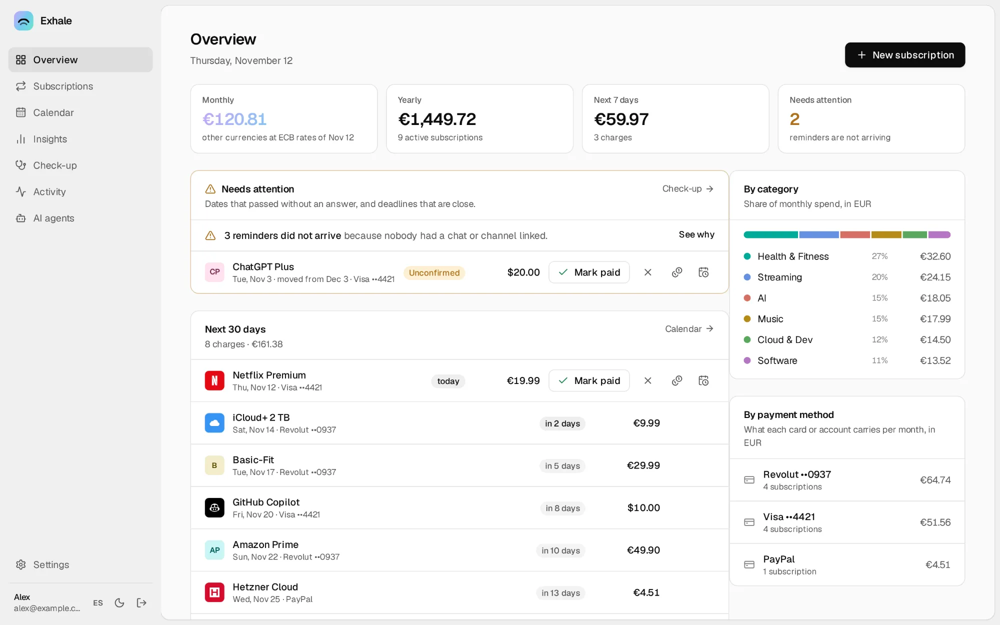

<div align="center">


# Exhale

### Breathe out. Your subscriptions are handled.

Exhale reminds you before every renewal and lets you fix it **from the reminder itself**:<br>
mark it paid, move the date, change the card, cancel. In Telegram, Slack or your browser.<br>
It runs on your own computer, so your data stays with you.

[**Download**](https://akamachinecode.github.io/exhale/#download) · [Website](https://akamachinecode.github.io/exhale/) · [Docs](https://akamachinecode.github.io/exhale/docs/) · [Changelog](CHANGELOG.md)

[](https://github.com/akamachinecode/exhale/releases/latest)
[](https://github.com/akamachinecode/exhale/actions/workflows/ci.yml)
[](LICENSE)


Free and open source · English and Spanish

</div>

<picture>
  <source media="(prefers-color-scheme: dark)" srcset="site/img/app-dark.webp">
  
</picture>

## The reminder is the app

Most tools tell you Netflix renews in three days and leave the rest to you. Exhale's reminder is where you deal with it. This is a real one, in Telegram:

```text
🔔 Spotify Family renews in 3 days
   💶 €17.99 · Sun, 8 Nov 2026
   💳 Revolut ••0937

   [ ✅ Already paid ]      [ 📅 Change date ]
   [ 💳 Payment method ]    [ ✏️ Amount ]
   [ ⏭ Skip this one ]      [ ❌ Cancel subscription ]
   [ 💤 Remind me tomorrow ] [ 💤 In 3 days ]
```

One tap and the message updates in place, with an undo. The web updates at the same moment.

## Why people switch to Exhale

|  |  |
|---|---|
| 🔔 **Reminders you can answer** | Already paid, a new date (this charge or from now on), another amount or card, skip, cancel, undo. One tap in the message, and it updates in place. |
| ⏳ **The dates that cost money** | Free trials before they charge, the last day to cancel, renewals that need you (domains, licences), fixed-term contracts and price rises announced ahead. |
| 🔍 **Find the ones you forgot** | Import a bank export (CSV) or a PDF statement and Exhale finds the charges that repeat, with no AI needed. Later statements show what was paid, what changed price and what never arrived. |
| 📱 **The whole app in a chat message** | A pinned Telegram or Slack message is Exhale itself: spend, upcoming charges, every subscription, an add wizard, payment methods and settings. It redraws when anything changes. Send the bot a statement to import it. |
| 🩺 **A check-up of facts, not tips** | The same service paid twice, prices that went up this year, trials about to charge, a card about to expire and everything that depends on it. |
| 💻 **Awake when it matters** | An icon in the menu bar (or the tray) with your next charges. Keep a laptop awake for an hour or a night, even with the lid closed, never down to an empty battery. What was due while it slept goes out when it wakes. |
| 📲 **On your phone, no app store** | Install the web as an app and get push notifications with a button that works from the notification. Or reminders by email, ntfy and webhook. |
| 📆 **Billing days as banks charge them** | Day 31 in short months, "the third Wednesday", weekends moved to a business day. Counted from the first charge, so dates never drift. |
| 💶 **Every currency, exact** | Totals in your currency at ECB rates, what each subscription has really cost you, and how much to set aside each month for the yearly bills. |
| 👥 **Shared, not mixed** | A partner or flatmates get their own account and reminders. Split a subscription and see who owes whom. Private ones stay private. |
| 🤖 **Ask it anything** | Plain language in chat, or Claude, ChatGPT and local models over MCP. Every change shows a preview first and can be undone. |
| 📥 **Bring everything with you** | Import from Wallos or a spreadsheet. Export it all as JSON, CSV or ZIP, or follow your charges in your calendar. |
| 🔒 **Yours, on your computer** | One program, one data folder, a backup every day. No cloud, no telemetry, no account with us, no paid tier. |

## Download

| | |
|---|---|
| **macOS** 12+ | [`Exhale.dmg`, Apple silicon and Intel](https://akamachinecode.github.io/exhale/#download-mac) |
| **Windows** 10/11 | [`Exhale-Setup.exe`, or a `.zip` for x64 and ARM64](https://akamachinecode.github.io/exhale/#download-windows) |
| **Linux** | [`.deb`, `.rpm` or `.tar.gz`, x86-64, ARM64 and ARM 32-bit (Raspberry Pi)](https://akamachinecode.github.io/exhale/#download-linux) |
| **Server or NAS** | [Docker image](https://akamachinecode.github.io/exhale/#download-server), `ghcr.io/akamachinecode/exhale` |

Or from a terminal:

```sh
curl -fsSL https://akamachinecode.github.io/exhale/install.sh | sh -s -- --service   # Linux, as a systemd service
docker run -d --name exhale --restart unless-stopped \
  -p 8484:8484 -v exhale-data:/data ghcr.io/akamachinecode/exhale                   # anywhere with Docker
```

Every release has cosign-signed checksums and build provenance. The [install guide](https://akamachinecode.github.io/exhale/docs/install/) covers first-launch prompts, [verifying downloads](https://akamachinecode.github.io/exhale/docs/install/linux/#verify-a-download), [HTTPS and remote access](docs/install/https.md), [backups](docs/install/backups.md) and [single sign-on](docs/install/sso.md).

## Quick start

1. **Open Exhale.** It opens in its own window and starts by itself with your computer. On a server, open `http://<server>:8484` and enter the one-time setup code from the log (`docker logs exhale`).
2. **Create your account.** The home page walks you through the rest. Making your own Telegram bot takes a minute and is guided.
3. **Add your subscriptions.** By hand, from Wallos or a spreadsheet, or from your bank statement. Reminders start the same day.

No public address needed: Exhale talks to Telegram and Slack with outgoing connections only, so it works behind a home router. An always-on machine (a home server, a Raspberry Pi, a VPS) never misses a reminder.

## Questions before installing

<details>
<summary><b>Does my computer have to be on?</b></summary>

Reminders go out while Exhale is running. On a laptop, Exhale can keep it awake for a while, even with the lid closed, from its menu bar icon or Settings → This computer, and anything due while it slept is sent when it wakes. A home server or a Raspberry Pi that never sleeps is ideal.
</details>

<details>
<summary><b>Where is my data?</b></summary>

In one folder on your computer, backed up every day. Nothing is sent anywhere unless you set up a channel such as Telegram.
</details>

<details>
<summary><b>Can I use it on my phone?</b></summary>

Yes. Reminders reach your phone through Telegram or Slack, or as push notifications once you install the web as an app (it needs HTTPS). Exhale itself runs on a computer.
</details>

<details>
<summary><b>Is it really free?</b></summary>

Yes. Exhale is free software under the AGPL-3.0, with no paid tier, no account with us and no telemetry.
</details>

<details>
<summary><b>I use Wallos. Can I move over?</b></summary>

Yes. Import your Wallos database and review every subscription before it is saved.
</details>

## Learn more

The **[documentation site](https://akamachinecode.github.io/exhale/docs/)** has every guide, with search, the REST API reference and [`llms.txt`](https://akamachinecode.github.io/exhale/docs/llms.txt) for language models. A few places to start:

- [Reminders that end in an answer](docs/guides/reminders.md) and [reminders by email, ntfy and webhook](docs/guides/notifications.md)
- [Slack](docs/guides/slack.md) and [Exhale for a team](docs/guides/teams.md)
- [The in-app assistant](docs/guides/assistant.md) and [connecting a remote AI agent](docs/guides/remote-agents.md)
- [Tools for many subscriptions](docs/guides/many-subscriptions.md)
- [Vision](docs/vision.md) and [architecture decisions](docs/adr/README.md)

## Status

Exhale is young (v0.x) and used every day by its author. Expect rough edges and tell us about them in [Issues](https://github.com/akamachinecode/exhale/issues); read the [changelog](CHANGELOG.md) before upgrading.

## Contributing

Contributions are welcome, from a translation ([two JSON files](docs/guides/translating.md)) to a new feature. Read [CONTRIBUTING.md](CONTRIBUTING.md) and [AGENTS.md](AGENTS.md), the map of the code for people and coding agents. Every technical decision is recorded as an [ADR](docs/adr/README.md).

```sh
git clone https://github.com/akamachinecode/exhale && cd exhale
mise install        # Go, Node, pnpm and the other tools
mise run build      # builds the web UI into the binary: bin/exhale
./bin/exhale serve  # http://127.0.0.1:8484
mise run test       # Go tests with the race detector
```

Report vulnerabilities as described in [SECURITY.md](SECURITY.md).

## Licence

[AGPL-3.0-or-later](LICENSE). Free to use, change and share.
